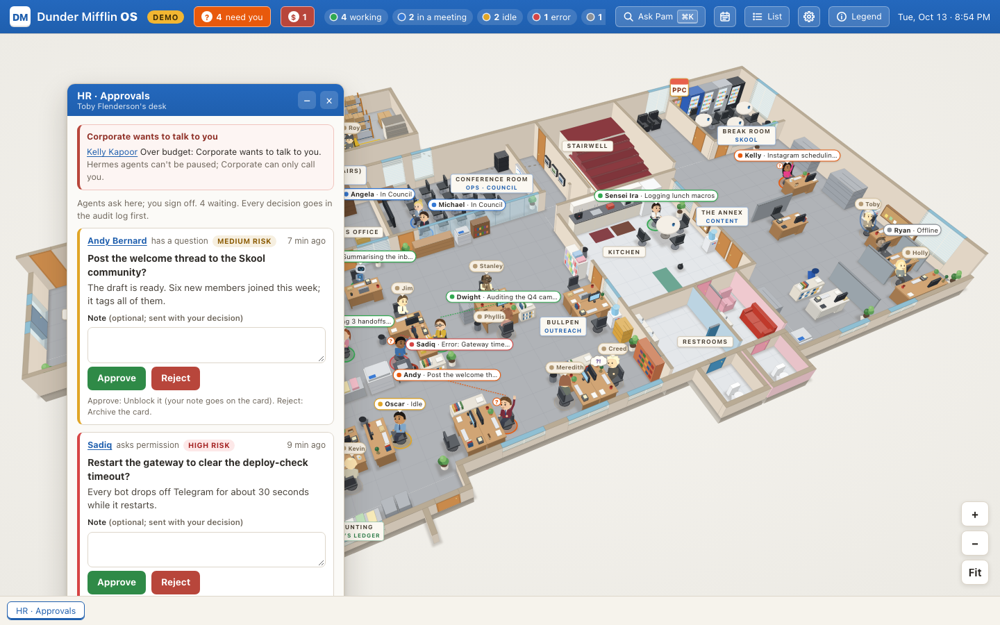
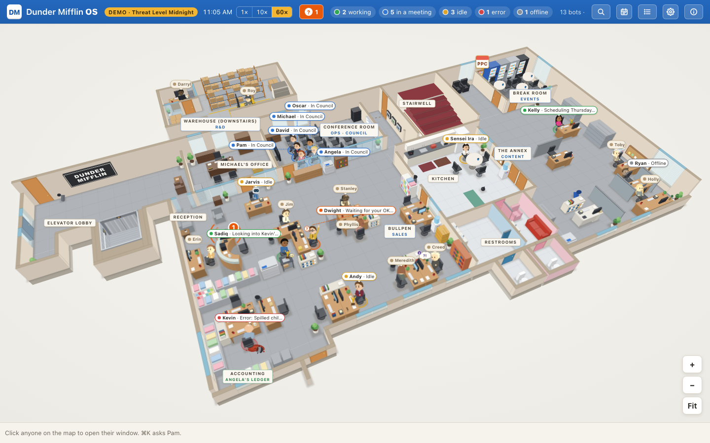
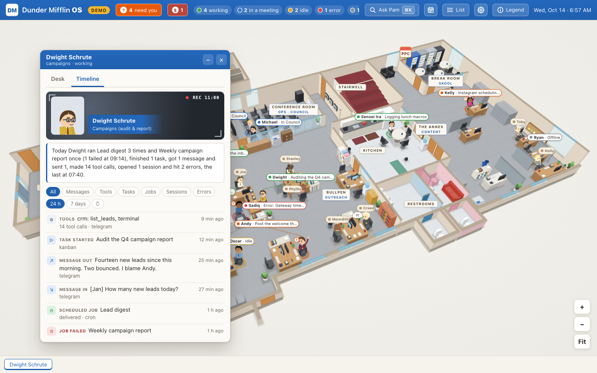
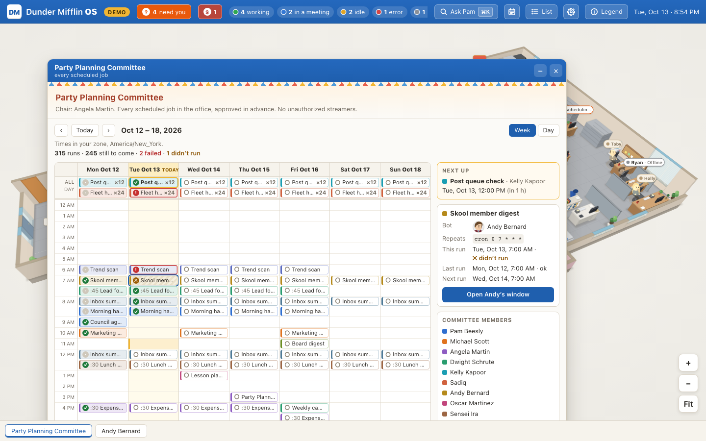
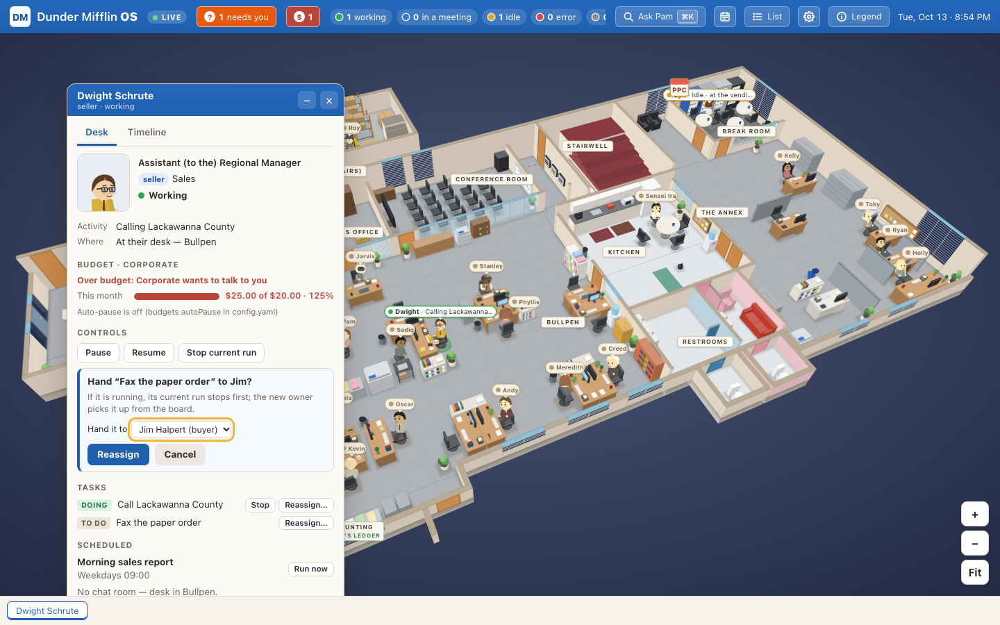
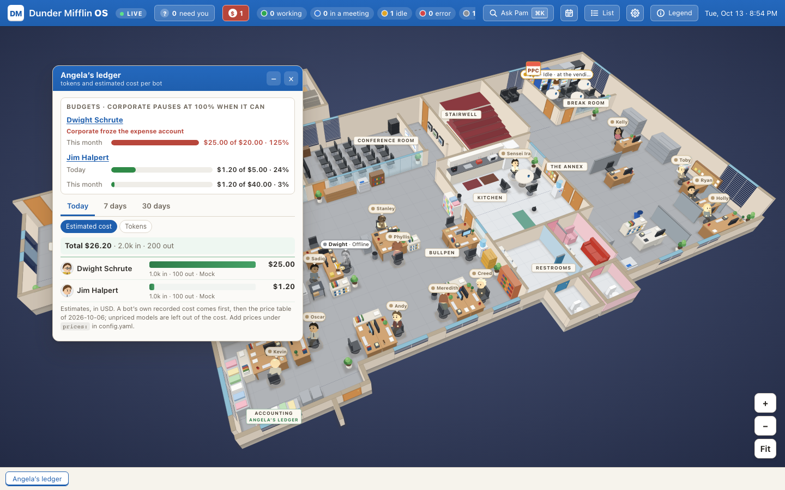
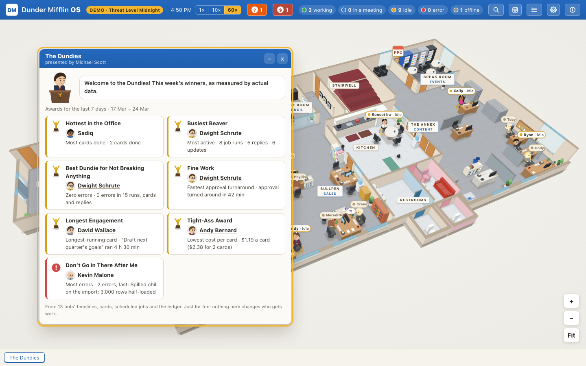
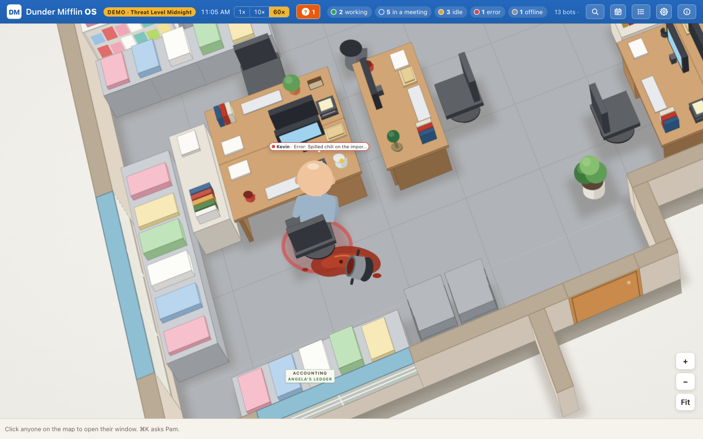

# Dunder Mifflin OS

> [!IMPORTANT]
> **Dunder Mifflin OS is an unofficial fan project. It is not affiliated with, endorsed by or sponsored by
> NBCUniversal or The Office.** "The Office", "Dunder Mifflin" and the show's characters belong to their owners. The
> project ships no photos, logos, stills or audio from the show; the characters are original drawings.

**[Try the demo in your browser](https://stephenlthorn.github.io/dunder-mifflin-os/)**: a scripted, fictional day at
the office, running entirely in the page (no server, no keys, no data leaves your browser).

A browser "operating system" for a [Hermes](https://hermes-agent.nousresearch.com) bot fleet, themed as the Scranton
branch office. The home screen is an isometric floor plan: all 23 staff sit at their desks. The 12 who have a Hermes
bot show a live status. Everyone else shows "No bot yet". Click a person to open their window (persona, role, status,
tasks, scheduled jobs, direct-line chat). Click a room to open its room window (members, shared tasks, room chat). The
Conference Room hosts the Ops and Council rooms, and bots working a shared task are drawn there.

When a bot needs you, its hand goes up with a "?", Pam's reception phone rings and the top bar says "N need you".
Toby Flenderson's HR desk is the approvals inbox: click Toby (he still has no bot) to approve or reject what your
agents wait on, with a note. See [docs/adapters](docs/adapters/README.md#approvals-the-inbox-at-tobys-desk).



Hermes is one agent source among several: any script that can POST JSON (webhook) and Claude Code sessions (its http
hooks) can sit at desks too, and a config file decides which character each agent becomes. See
[docs/adapters](docs/adapters/README.md).



It is **local-first and read-only by default**: it listens on `127.0.0.1`, only reads your Hermes files, and chat and
task creation stay off until you turn them on. How it fits together: [docs/ARCHITECTURE.md](docs/ARCHITECTURE.md).

## Try it in 10 seconds

Open the [static demo](https://stephenlthorn.github.io/dunder-mifflin-os/), or run it locally:

```sh
git clone https://github.com/stephenlthorn/dunder-mifflin-os.git
cd dunder-mifflin-os && npm install && npm run demo -- --open
```

No keys, no Hermes, no network calls. The demo day, **"Threat Level Midnight"**, plays a scripted, fictional day at the
branch at 60x (a day in nine minutes; the top bar switches to 10x or 1x), then starts over:

- the bots arrive and work their cards, and four of them hold a morning standup in the Conference Room;
- late morning the Council meets there (five bots walk over), Kevin's import spills chili (the day's one error) and
  Dwight waits for your OK before emailing 40 leads (**needs you**);
- scheduled jobs fire all day, Ops reviews the spill after lunch, and everyone goes home at 17:30.

Message any bot for a canned, in-character reply, or give one a shared task from the Ops room: ten office minutes
later it walks to the Conference Room to work on it. The ten staff without a bot stay "No bot yet". The same day runs
from `npm run demo` in a checkout, `docker compose --profile demo up demo`, or a static copy with no server at all
(the [online demo](https://stephenlthorn.github.io/dunder-mifflin-os/); see [Demo mode](#demo-mode-threat-level-midnight)).

## Quick start

You need Node 22.13+ (for npx and from source) or Docker.

**npx** (once the package is published to npm; it ships the built app):

```sh
npx dunder-mifflin-os --demo --open   # the demo day: scripted bots, nothing read from Hermes
npx dunder-mifflin-os --open          # live: reads ~/.hermes, read-only
```

It prints the URL (http://127.0.0.1:4318) and what it is doing. Options: `--demo`, `--speed <1|10|60>` (demo only),
`--open`, `--port <n>`, `--hermes-home <dir>`, `--portraits <dir>`, `--allow-writes`, `--help`.

**Docker**:

```sh
docker compose --profile demo up demo                        # the demo day: no token, no Hermes, no mounts
echo "DMOS_ACCESS_TOKEN=$(openssl rand -hex 24)" >> .env   # once, for live data; .env is git-ignored
docker compose up -d                                         # live: mounts ~/.hermes read-only
```

Open http://localhost:4318. The container listens on 0.0.0.0, which counts as remote, so live data always needs an
access token: sign in once with the token from `.env` (without one the live container refuses to start and logs
why). The demo needs none, because it serves only fiction. Compose publishes the port on `127.0.0.1` only, mounts
`~/.hermes` and the portraits and headshots directories read-only (live only), and runs the container as a non-root
user with a read-only filesystem. Set `DMOS_PORT` in `.env` to use another port.

**From source**:

```sh
npm install
npm run start          # builds the web app, serves the live office at http://127.0.0.1:4318
npm run demo           # builds the web app, then the demo day at http://127.0.0.1:4318 (npm run demo -- --open)
```

## Demo mode ("Threat Level Midnight")

The `demo` agent adapter (`server/src/adapters/demo/`; the day itself is data in `shared/demo/`) plays the scripted
day described [above](#try-it-in-10-seconds). It reads nothing from disk or the network and needs no keys. The top
bar shows **DEMO · Threat Level Midnight**, the office clock and the speed control (1x, 10x, 60x).

- **Server:** `npx dunder-mifflin-os --demo`, `npm run demo` and `docker compose --profile demo up demo` run the
  server with `DMOS_SOURCE=demo`: the demo alone, whatever your config file says. Chat, new tasks and the control
  verbs (stop a card, run a job now, reassign) are on and stay in memory (they are gone when the day starts over, and
  they are audited in memory, not in your audit log); photos and headshots are off. Angela's ledger and Corporate's
  budgets show the day's scripted, fictional usage.
- **Static, no server:** `npm run build:demo-static` writes a self-contained site to `web/dist-demo/` with relative
  paths, so it works from any sub-path. The [Pages workflow](.github/workflows/pages.yml) builds it on every push to
  `main` and publishes it at https://stephenlthorn.github.io/dunder-mifflin-os/. The browser runs the same adapter and office code
  as the server, so it shows exactly the same day. Its address takes `?speed=1|10|60`, `?at=10:25` (where the day
  starts) and `?seed=7`. While developing, `npm run dev:web` serves it at http://127.0.0.1:5173/demo.html.
- **Settings:** `DMOS_DEMO_SPEED`, `DMOS_DEMO_START` (`HH:MM`, default 08:55) and `DMOS_DEMO_SEED`, or an entry like
  `{ kind: demo, speed: 10, start: '10:25', seed: 7 }` under `adapters:` in the config file.
- **Deterministic:** for a given start, speed and seed the day always plays the same (the seed varies only the small
  jobs idle bots pick up and which canned reply comes back), so the e2e tests and `docs/screenshots/` are stable.

The older fixed sample is still there for tests: `?demo=1` on any URL shows a built-in demo snapshot (chat and new
tasks are local echoes), and the web app falls back to it, with **Demo** in the top bar, when the server can't be
reached. `DMOS_SOURCE=fixture` runs the server on the recorded, redacted Hermes sample (`server/fixtures/`).

## Connecting Hermes

By default the server reads `~/.hermes`; point it elsewhere with `--hermes-home <dir>` or `HERMES_HOME`. It only
reads (see [Where status comes from](#where-status-comes-from)) and never writes Hermes files. The bots' live status
also comes from the Hermes status API at `127.0.0.1:9119` when it is up (`DMOS_STATUS_URL`; compose points it at
`host.docker.internal`).

Chat and creating shared tasks are **off** until you start the server with `--allow-writes` (`DMOS_ALLOW_WRITES=1`).
They run the `hermes` CLI (`DMOS_HERMES_BIN`, default `~/.local/bin/hermes`), so they need Hermes on the same machine;
the Docker image doesn't include it. While writes are off, the windows show the history and a hint instead of the
composer, the approvals inbox shows its buttons switched off, and the top bar says **Read-only**. Approval decisions
also need a writable audit log; in Docker (read-only filesystem) mount a directory and point `DMOS_AUDIT_LOG` at it.

## Settings

Environment variables (the CLI flags set the same things):

| Variable | Default | What it does |
|---|---|---|
| `DMOS_PORT` | `4318` | Port (`--port`) |
| `DMOS_HOST` | `127.0.0.1` | Bind address. Anything beyond loopback (e.g. `0.0.0.0`) requires `DMOS_ACCESS_TOKEN`, except for the demo |
| `DMOS_ALLOW_WRITES` | off | `1` turns on chat, task creation and control verbs (`--allow-writes`) |
| `DMOS_ACCESS_TOKEN` | none | Sign-in token (16+ characters). Required for remote access; optional locally |
| `DMOS_PUBLIC_ORIGINS` | none | Comma-separated https origins the app is published at (e.g. `tailscale serve`); requires a token |
| `HERMES_HOME` | `~/.hermes` | Hermes home (`--hermes-home`) |
| `DMOS_PORTRAITS_DIR` | `~/.dunder-mifflin-os/portraits` | Local staff photos (`--portraits`) |
| `DMOS_HEADSHOTS_DIR` | `~/.dunder-mifflin-os/headshots` | Local bot headshots, `<profile>.jpg` or `.png`, used when a person has no portrait |
| `DMOS_SOURCE` | live | `demo` = the demo day alone (`--demo`); `fixture` = the recorded Hermes sample |
| `DMOS_DEMO_SPEED`, `DMOS_DEMO_START`, `DMOS_DEMO_SEED` | `60`, `08:55`, `1` | The demo day's speed (1, 10 or 60; `--speed`), start time and seed |
| `DMOS_HERMES_BIN` | `~/.local/bin/hermes` | Hermes CLI used for chat and new tasks |
| `DMOS_STATUS_URL` | `http://127.0.0.1:9119/api/status` | Hermes status API |
| `DMOS_POLL_MS` | `5000` | How often to poll Hermes while a browser is connected |
| `DMOS_SERVE_WEB`, `DMOS_WEB_DIST` | off, `web/dist` | Serve the built app (the CLI and `npm run start` turn this on) |
| `DMOS_CONFIG` | `~/.dunder-mifflin-os/config.yaml` | Which agent adapters run and which character each agent becomes ([docs/adapters](docs/adapters/README.md#config)) |
| `DMOS_INGEST_TOKEN` | none | Bearer token (24+ characters) for the webhook and Claude Code adapters; required when either is configured |
| `DMOS_AUDIT_LOG` | `~/.dunder-mifflin-os/audit.log` | Append-only log of approval decisions and control verbs, written before each one is carried out (no log, no action) |

## Development

| Command | What it does | Open |
|---|---|---|
| `npm run start` | Builds the web app, then starts the server in **live** mode (reads `~/.hermes`). The server also serves the app. | http://127.0.0.1:4318 |
| `npm run dev` | Live server (auto-restarts) and the Vite dev server together. Vite proxies `/api` and `/login` to the server. | http://127.0.0.1:5173 |
| `npm run demo` | Builds the web app, then serves the demo day (`--demo` through the CLI). No keys, no Hermes. | http://127.0.0.1:4318 |
| `npm run build:demo-static` | Builds the static demo (no server) into `web/dist-demo/`. | |
| `npm run demo:server` | Server on the recorded, redacted fixture (`server/fixtures/`) plus Vite. | http://127.0.0.1:5173 |
| `npm test` | Unit tests: web + shared (`vitest`), then server (`server/vitest.config.ts`). | |
| `npm run e2e` | Playwright tests of the web app against mocked APIs (`DMOS_E2E_PORT` picks another dev-server port). | |
| `npm run e2e:auth` | Playwright sign-in test against the real server with an access token (fixture data). | |
| `npm run e2e:demo` | Playwright tests of the static demo (served from a sub-path, like GitHub Pages) and the server's demo day. | |
| `npm run e2e:live` | Playwright tests against the **real** `~/.hermes`, read-only, on port 4328. Writes `docs/screenshots/live-*.png` (git-ignored because they show real task and job titles). | |
| `npm run typecheck` | `tsc` for web (incl. shared) and server. | |
| `npm run screenshots` | Regenerates `docs/screenshots/` from the demo day at 11:05, with the browser clock paused. | |
| `npm run portraits:check` | Lists who has a local portrait photo and who doesn't (see [Portraits](#portraits)). | |

`npm run dev` and `npm run start` are read-only too; add `DMOS_ALLOW_WRITES=1` in front to chat from the browser.
See [CONTRIBUTING.md](CONTRIBUTING.md) for how to contribute.

## Ask Pam, keyboard, phones and notifications

- **Ask Pam** (⌘K / Ctrl+K, `/`, or the top-bar button): Pam at reception answers the phone. Fuzzy search over people,
  bots ("Chat with Dwight", only when the server allows writes and the agent can chat), rooms, places, tasks and
  scheduled jobs; `s:error` (or `working`, `idle`, `meeting`, `offline`, `needs-input`) narrows to one status. Enter opens; Shift+Enter shows them on the map (the camera glides there).
  It also opens the Conference Room, sets a fleet filter (only working, needs-you or errors), switches to the list
  view, and opens the shortcuts and settings. Recent picks are listed first.
- **Keyboard on the map:** Tab / Shift+Tab and the arrow keys move between people and room signs in reading order,
  Home / End jump to the ends, Enter or Space opens, Esc closes the top window, and `?` lists every shortcut.
- **Phones:** below 720 px wide the map becomes a list grouped by where people are (Reception, Bullpen, …) with status
  and activity; windows open as full-screen sheets. The Map / List button in the top bar switches on any screen.
- **Notifications:** when a bot changes to `error` or `needs-input` (waiting on you) while this tab is in the
  background, the title becomes "(1) Dunder Mifflin OS" and the favicon gets a red dot. When you come back, a "While you
  were away" card lists what changed. Browser notifications and a chime (an original synthesised bell) stay off until
  you switch them on under Settings (the gear); the browser's permission prompt appears only then, never on load.
- **Settings** (shortcuts, notifications, chime, reduce motion) and Ask Pam's recent items live in this browser's
  localStorage (`dmos.prefs.v1`, `dmos.pam.recents.v1`). Nothing goes to the server.

## Timeline and Angela's ledger

**The documentary crew.** A bot's window has a **Timeline** tab: a talking-head card sums up its day ("Today Dwight
ran Lead digest 3 times and Weekly campaign report once (1 failed at 09:14), finished 1 task, …", made from the events
by a template, no LLM call), then what it did, newest first: sessions, messages in and out, tool calls (folded per
session), tasks, scheduled-job runs and errors. Filter by kind; look back 24 hours or 7 days. Messages show only a
short, scrubbed one-line summary, and tasks only their title.

**Angela's ledger.** Click the *Accounting · Angela's ledger* sign by her desk (or ask Pam for "ledger") to see
tokens and estimated cost per bot for today, 7 or 30 days, biggest first, with bars to scale and totals. Click a name
for that bot's timeline. Adapters that keep no token counts (webhook, Claude Code) say "No usage data" instead of 0.



- **Where it comes from (Hermes, read-only):** `profiles/<bot>/state.db` (`sessions`, `messages`, and tokens per model
  in `session_model_usage`), `kanban.db` (`task_runs`), `profiles/<bot>/cron/executions.db` + `jobs.json`, and
  `profiles/<bot>/logs/errors.log` (ERROR lines). Endpoints: `GET /api/people/:id/timeline?since=<ISO>&limit=<n>` and
  `GET /api/usage?period=today|7d|30d`, behind the same sign-in as the rest.
- **Costs are estimates.** A bot's own recorded cost (Hermes' cost columns) comes first, then a small, dated price
  table (`server/src/usage/priceTable.ts`, list prices as of 2026-10-06; never fetched from the network). Models without
  a price are counted in tokens and named as unpriced. Add or correct prices in `~/.dunder-mifflin-os/config.yaml`:

  ```yaml
  prices:
    asOf: 2026-11-01
    models:
      MiniMax-M3.1-Flash-Preview: { input: 0.3, output: 1.2, cacheRead: 0.06 }   # USD per million tokens
  ```

## Party Planning Committee calendar and Conference Room minutes



- **Calendar** (the top bar's Calendar button, the PPC notice on the break room's bulletin board, the Break Room
  window, or Ask Pam): every scheduled job of every bot as runs in a week or day view, in your browser's time zone,
  coloured by bot. A past run shows how it went when that is known: the last run's result (✓ ran OK, ! failed), or ✕
  for a run that was due after the last one and didn't happen. Jobs that run more than six times a day get one summary
  per day. Click a run to see its job; its bot's window opens too. Cron expressions are expanded by a small built-in
  5-field parser (`shared/schedule/`) in the zone the job runs in (Hermes: the profile's `timezone`, else the
  server's). A time skipped by a DST change runs right after the gap; a repeated one runs once.
- **Minutes** (the Conference Room window's Minutes tab, or Ask Pam): every Council session and shared task of the
  last 7 or 30 days as a printable memo. It lists who was present, the agenda, the proceedings with times (who picked
  up what, status changes, comments) and the outcome (run summaries). The minutes are built from the kanban record,
  never by an LLM, and free text is scrubbed and clipped like everything else.
- **API**: `GET /api/schedule?from&to` (ISO times; default a day ago to a week ahead, at most 42 days) and
  `GET /api/meetings?from&to` (default the last two weeks, at most 92 days). Both only read and need sign-in when a
  token is set. An adapter provides minutes with the optional `meetings(period)` method
  ([docs/adapters](docs/adapters/README.md#the-contract)).

## Control verbs and budgets ("Corporate")



- **Control verbs** in a bot's window and in Ask Pam: **Pause** / **Resume** a bot, **Stop** its running card or run,
  **Run now** on a scheduled job, **Reassign…** a card to another bot of the same kind. Each verb opens a confirmation
  in the window that says what will happen (Confirm or Cancel; Esc cancels), and nothing is sent until you confirm.
  The office only offers what the bot's adapter can do, only with writes on (`--allow-writes`), and writes each verb to
  the audit log before it runs it.

  | Adapter | Pause / Resume | Stop | Run a job now | Reassign a card |
  |---|---|---|---|---|
  | `hermes` | no: `hermes pause` is fleet-wide (see below) | a running kanban card: `hermes kanban reclaim <id>` then `hermes kanban block --kind needs_input <id> …` | `hermes -p <profile> cron run <id>` | `hermes kanban reassign <id> <profile> --reclaim` |
  | `webhook` | yes, when the agent sent a `controls` event: a signed `control` event to its callback | same | no | no |
  | `claude-code` | no (hooks can end a turn, not hold one) | yes: the session's next tool hook is answered `{"continue": false}` | no | no |
  | `demo` | no | a running card, parked as blocked for the rest of the demo day | yes, in memory | yes, in memory |

  Hermes has no safe per-bot pause: `hermes pause` stops the whole fleet, `hermes -p <bot> resume` also lifts a
  fleet-wide stop, and kanban dispatch runs in one gateway for every bot. A stopped Hermes card is parked as blocked
  so it isn't started again; it then waits in HR · Approvals, where **Unblock** runs it again. "Run now" answers
  after a few seconds and lets a long job finish in the background (it shows on the timeline).
- **Budgets.** Per bot, in USD, per day and/or calendar month (server local time), in
  `~/.dunder-mifflin-os/config.yaml`:

  ```yaml
  budgets:
    autoPause: false            # default; true lets Corporate pause a bot at 100% when its adapter can pause
    dwight: { monthly: 20 }
    kelly: { daily: 1.5, monthly: 30 }
  ```

  The bot's window and Angela's ledger show a gauge per budget (amber from 80%, red at 100%) using the ledger's cost
  estimates. At 100% **Corporate freezes the expense account**: it pauses the bot (audited as `corporate`) only when
  `autoPause` is true *and* the bot's adapter can pause; otherwise the bot is counted in "N need you", listed in HR ·
  Approvals and the top bar shows a red Corporate badge. One attempt per bot per day or month, so a bot you resume
  stays resumed until the next period. Usage of a model without a price is never counted as spend and never pauses
  anything; the gauge says "can't price <model>" (add prices under `prices:`). The demo day brings its own budgets
  and scripted usage (Kelly goes over her daily budget in the afternoon; Kevin runs a model nobody priced) and audits
  in memory.
- **API**: `POST /api/people/:id/actions` with `{"action": "pause" | "resume" | "stop" | "run-job" | "reassign",
  "args": {…}}` (`stop` may name `taskId`; `run-job` needs `jobId`; `reassign` needs `taskId` and `to`, a person id) and
  `GET /api/budgets`. Both need sign-in when a token is set and are rate-limited (20 verbs and 60 budget reads a
  minute); the verbs also need `--allow-writes`. The server checks budgets every minute on its own.



## The Dundies, Creed's corner and Toby mode

Every joke carries real information, none of them blocks a click, and all of them respect reduced motion (the system
setting or Settings). Sounds play only with the **Chime** setting on (off by default).



- **The Dundies** (Ask Pam: "dundies", or Michael's invitation on Friday evenings): this week's awards, each won on a
  number from the bots' own records (timelines, cards, scheduled jobs, the ledger), with the number as the reason:
  *Hottest in the Office* (most cards done), *Busiest Beaver* (most activity), *Best Dundie for Not Breaking Anything*
  (zero errors, most work), *Fine Work* (fastest approval turnaround: blocked card to back at work), *Longest
  Engagement*, the *Tight-Ass Award* (lowest cost per card) and *Don't Go in There After Me* (most errors). Winners
  keep a trophy on their desk. Deterministic, and never fed back into who gets work.
- **Kevin's chili spill**: a bot in error spills chili at its desk (once, not on a loop); its chip keeps the real error.
- **Creed's corner** (click Creed): activity no desk can hold, as reported: agents with no desk free, open cards nobody
  owns, requests from deskless agents (`GET /api/unattributed`). While there is any, Creed knows something.
- **Ambient life**: idle bots now and then get up for coffee, the vending machine or the water cooler (seeded, rare,
  never with reduced motion); light through the windows follows the clock; Dwight's bobblehead nods when the bot at his
  desk finishes a run.
- **Easter eggs**: "that's what she said" on certain chat lines (a toast in your browser only; nothing is sent to a
  bot), the Konami code (the *Threat Level Midnight* credits, starring your actual roster), the World's Best Boss mug on
  Michael's desk (who is waiting on you), Stanley's crossword at 15:00 (today's cards done is an answer), Pretzel Day
  (19 October), and "Parkour!" when you flick the map.
- **Toby mode** (Settings, or `?toby=1`): no jokes, ambient life, sounds or easter eggs. The same information as a
  plain dashboard: the *Weekly review* with neutral award names, *Unattributed activity*, plain status rings.



## Where status comes from

The server reads Hermes through the `hermes` agent adapter (`server/src/adapters/hermes.ts`, reading with
`server/src/hermes/liveSource.ts`). It only reads; it never writes Hermes files:

- **Gateway**: the status API at `127.0.0.1:9119/api/status`, or `~/.hermes/gateway_state.json` when the API is down.
  This gives each bot's Telegram connection state and error code.
- **Kanban**: `~/.hermes/kanban.db` (cards, running runs and heartbeats, links, notify subscriptions that tie a card to a room;
  for the minutes also comments, run summaries and status-change events, never card bodies or event payloads).
- **Sessions**: `profiles/<bot>/state.db` (last activity, group titles, room messages).
- **Scheduled jobs**: `profiles/<bot>/cron/jobs.json` (names, schedules, last and next run), and `timezone` from
  `profiles/<bot>/config.yaml`. **Names**: `personas/personas.json`.

Status rule (`server/src/domain/presence.ts`), first match wins:

| Status | When |
|---|---|
| offline | gateway not running or unreadable, or the bot's Telegram platform isn't connected |
| error | Telegram error code, or a run that crashed or timed out, or a failed scheduled job, in the last 60 min |
| meeting | a running run on a **shared** task (its room is Ops or Council, or it's linked to another bot's card). The bot is drawn in that room. |
| working | a running run with a heartbeat under 5 min old, or session activity under 5 min old |
| idle | anything else |

The server polls every 5 s while a browser is connected and pushes changes over `GET /api/events` (SSE).

## Rooms and where they are on the map

| Room | Lead | Members | Location |
|---|---|---|---|
| Ops (shared tasks) | Sadiq (tech) | tech | Conference Room |
| Council | Pam (chief) chairs | chief, tech, strategist, ai-strategist, cmo, cfo | Conference Room |
| HQ | Pam (chief) | chief | Reception |
| Content | Kelly (social) | social | The Annex |
| Outreach | Dwight (campaigns) | campaigns | Bullpen |
| Skool | Andy (skool) | skool | Break Room |
| R&D | Sadiq (tech) | tech, ai-strategist | Warehouse |
| Direct line (one per bot) | that bot | that bot | the bot's desk area |

Jarvis (general), Sensei Ira (health) and Oscar (teacher) only have direct lines. Room definitions live in `server/src/rooms.ts`.
A room is linked to its Telegram group by name, on the server. Chat ids never reach the browser.

## Portraits

Everyone on the map is a drawn mini character. If you have photos of the staff, the person window, the room member
lists and the map's hover tooltip can show them instead. **Bring your own: the repo and the package ship no photos and
must never contain any.** Portraits stay on your machine.

- **Where they go:** outside the repo, in `~/.dunder-mifflin-os/portraits/` (or `--portraits <dir>` /
  `DMOS_PORTRAITS_DIR`; compose mounts it read-only), one file per person named after their id: `<id>.jpg` or
  `<id>.png`, for example `dwight.jpg` or `ira.jpg`. The ids are in `shared/office/staff.ts`. Square head-and-shoulders
  crops look best (1024 × 1024 is plenty).
- **What the server does:** `GET /api/portraits/<id>` answers only for people on the map. It serves `<id>.jpg`, then
  `<id>.png`, and only real JPEG or PNG files. With no file, a person with a Hermes bot gets the bot's headshot
  (`<profile>.jpg` or `.png` in `~/.dunder-mifflin-os/headshots/`, or `DMOS_HEADSHOTS_DIR`) and everyone else gets a
  404. The browser then keeps the drawn character.
  Demo mode always uses the drawn characters.
- **Check what you have:** `npm run portraits:check` lists who has a portrait and who doesn't. It only reads the
  directory and never downloads anything.
- **Kept out of git:** `.gitignore` excludes any `portraits/` directory, `.dunder-mifflin-os/` and `portraits-*.png`
  screenshots, so a stray copy can't be committed. The screenshots in `docs/screenshots/` use the drawn characters.
- **IP note:** The Office, its characters and their photos belong to NBCUniversal. Use photos for personal, private use
  only: don't publish them or screenshots that show them.

## Moving someone to another desk

Seats, looks and the staff list are data in `shared/office/`. They aren't code:

1. **To a free seat that already exists**: in `shared/office/staff.ts`, change the person's `seatId`, for example to
   `seat.spare.2` in the bullpen. Each seat holds one person.
2. **To a new spot**: add or edit a seat in `shared/office/seats.ts` (`x`/`y` in floor units of about 0.5 m, `facing`,
   `areaId`, `chair`). Usually you'll also add a desk in `shared/office/furniture-*.ts`. Area rectangles are in
   `shared/office/areas.ts`.
3. **A bot's direct line follows its desk**: its room is drawn in the area of the seat, wherever that is.
4. Run `npm test`. The shared tests check that every person has a real, unique seat. A server test checks that
   `shared/office/staff.ts` and `server/src/roster.ts` agree on who is which bot. Then restart with `npm run start`
   (which rebuilds the app). `npm run dev` reloads on its own.

Which bot belongs to which person is set in `server/src/roster.ts` (the built-in seating). To change it without
editing code, map characters to agents in `~/.dunder-mifflin-os/config.yaml` under `seats:`
([docs/adapters](docs/adapters/README.md#config)). Display names come from Hermes personas when present,
unless the staff entry sets `keepName: true` (Sensei Ira does): then the map keeps its own name and the person's window
shows the persona name as a small "Hermes persona: …" line.

## Security model

The full threat model and how to report a problem are in [SECURITY.md](SECURITY.md). In short:

- **Local only by default.** The server binds `127.0.0.1`. Requests must carry a `127.0.0.1`/`localhost` Host header
  (or a configured public origin's host), which blocks DNS rebinding.
- **Approvals are audited.** Approving or rejecting from HR · Approvals is a write like any other, and each decision
  is appended to `~/.dunder-mifflin-os/audit.log` before it is carried out. Nothing is approved automatically.
- **Control verbs are audited too.** Pause, resume, stop, run-now and reassign need writes on, sign-in when it is on,
  the adapter's capability and a confirmation in the page, and each is appended to the audit log (with who asked:
  you, or `corporate` for a budget auto-pause) before it runs. Budget auto-pause is off unless `budgets.autoPause`.
- **Read-only by default.** Chat, task creation and every other write answer `403` until you start the server with
  `--allow-writes` / `DMOS_ALLOW_WRITES=1`. A POST that carries an `Origin` must come from the app's own origin (or the
  Vite dev origin), and every POST needs a JSON body. Creating cards is rate-limited.
- **A token for remote access.** Publishing the server (`DMOS_PUBLIC_ORIGINS`) or binding beyond loopback
  (`DMOS_HOST`, as in Docker) makes it refuse to start without `DMOS_ACCESS_TOKEN`. Browsers then sign in once on
  `/login`; the session cookie is `HttpOnly`, `SameSite=Strict` and `Secure` on https, holds an HMAC rather than the
  token, and sign-in attempts are rate-limited. The token is compared in constant time and never logged.
- **Secrets stay on the server.** The adapter never reads `.env`, `auth.json` or tokens. Telegram chat ids become
  opaque per-process HMAC keys inside the adapter and are never sent out. Free text that leaves the server (chat
  messages, task titles, activity, job names) is scrubbed of chat ids, `~/.hermes` and home paths, tokens or API keys,
  and phone numbers (`server/src/domain/scrub.ts`). `server/test/liveLeak.test.ts` scans every live `/api/*` response
  for these. It is skipped on machines without `~/.hermes`.
- **Talking to bots.** Chat runs `hermes -p <profile> chat …` through `execFile` (no shell), only for whitelisted
  profiles, with a length cap and one message in flight per bot. Room chat goes to the room's lead bot. Headshots are
  served only for whitelisted profile keys and portraits only for people on the map, without ever revealing a path.
- **Inbound agent endpoints** (`/api/ingest/:agentId`, `/api/hooks/claude-code`) exist only while their adapter is
  configured (otherwise `404`). Agents can't sign in with a cookie, so these skip the sign-in and need
  `Authorization: Bearer $DMOS_INGEST_TOKEN` instead (constant-time compare; the server won't start them without a
  token of 24+ characters). They validate every event, are rate-limited, keep data in memory only, scrub it like
  everything else, and work on a read-only server (they only report; they can't make an agent do anything). A write
  to an agent needs both `--allow-writes` and that agent's adapter capability. See [docs/adapters](docs/adapters/README.md).
- Logs go to stderr as JSON and are redacted. They never include message text, the access token or the ingest token.

## Open it from your other devices (Tailscale)

To reach the office from your phone or laptop on your tailnet, publish it with `tailscale serve` (tailnet only, not
Funnel), tell the server the published origin so its Host and Origin checks accept it, and give it an access token:

```sh
tailscale serve --bg --https=4318 http://127.0.0.1:4318
export DMOS_ACCESS_TOKEN="$(openssl rand -hex 24)"
echo "$DMOS_ACCESS_TOKEN"   # keep it in your password manager
DMOS_PUBLIC_ORIGINS=https://<machine>.<tailnet>.ts.net:4318 npx dunder-mifflin-os
```

Every browser signs in with the token once, including the one on the same machine. Stop publishing with
`tailscale serve --https=4318 off`. With `--allow-writes`, anyone who has the token can chat with
the bots and create shared tasks.

## Layout

```
bin/      dunder-mifflin-os.mjs: the npx entry (runs server/src/cli through tsx)
shared/   contract.ts (server ⇄ browser types), office.ts + office/ (floor plan, furniture, seats, staff), demo/ (the demo day), demo fixture
server/   node:http API + SSE + sign-in, agent adapters (hermes live/fixture, webhook, claude-code), office seating, static web/dist, CLI
web/      Vite + React + SVG isometric renderer, OS chrome (top bar, windows, taskbar), Playwright e2e (e2e/, e2e-live/)
docs/     ARCHITECTURE.md, adapters/ (agent sources) and screenshots
```

## Credits and acknowledgements

- **Layout inspiration:** the floor plan follows the well-known isometric render of the Scranton office by
  [Drawbotics](https://www.drawbotics.com/), as shared on
  [r/DunderMifflin](https://www.reddit.com/r/DunderMifflin/comments/5rnxeg/). The render itself is not included; the
  map is drawn from scratch as SVG.
- **The Office**, its names, characters and likenesses belong to NBCUniversal. This project is a tribute by a fan and
  is not connected to the show or its owners.
- **[Hermes](https://hermes-agent.nousresearch.com)** by Nous Research is the agent framework the office was built
  around; the webhook and Claude Code adapters work without it.
- Built with [React](https://react.dev), [Vite](https://vite.dev), [Playwright](https://playwright.dev) and
  [Vitest](https://vitest.dev).

## Licence

Code: [MIT](LICENSE), © Stephen Thorn. Original artwork and map data (the drawn characters, the floor plan, icons):
[CC BY 4.0](ASSETS-LICENSE). Neither grants any rights in The Office, its names, characters or likenesses, which
belong to NBCUniversal. Please read the [Code of Conduct](CODE_OF_CONDUCT.md) before taking part, and
[CONTRIBUTING.md](CONTRIBUTING.md) before opening a pull request.
